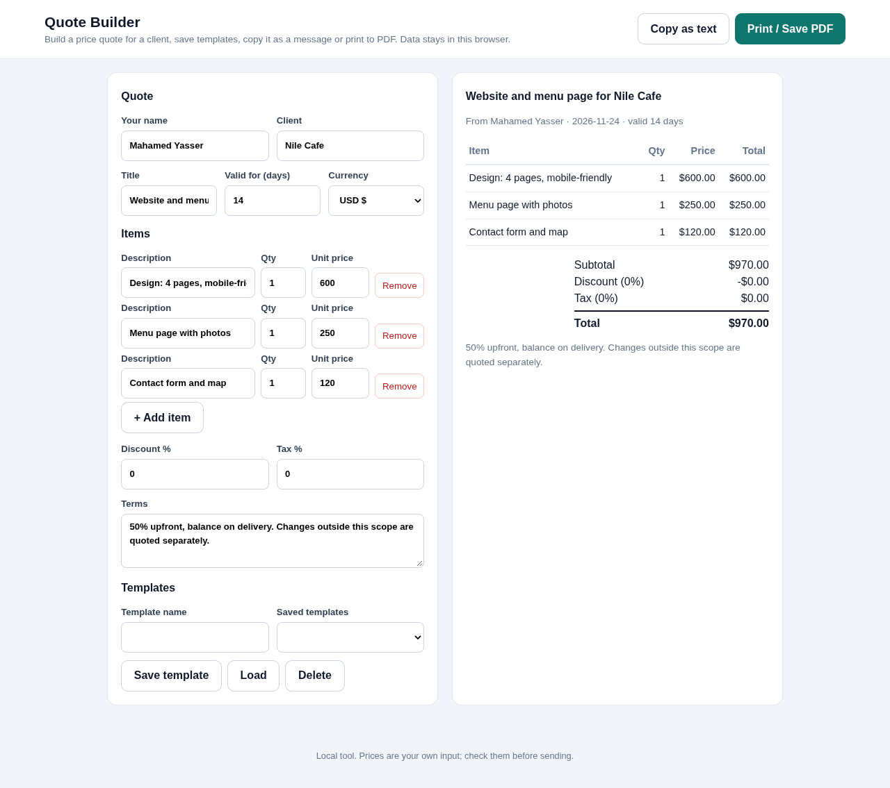

# Quote Builder

_Screenshot of the tool with sample data entered through the page (fictional names and numbers)._

Build a price quote for a client with line items, discount, tax, currency and terms. Copy it as a message or print to PDF. Save reusable templates.

## What it does
- Live totals with discount and tax, five currencies
- Validation for quantity, price, discount and tax
- Copy as plain text for a message, or print / save as PDF from the browser
- Save, load and delete templates
- Data saved in the browser

## Run it
Open `index.html` in a browser. No install, no build, no server, no account.

## Tests and limits
- Browser-tested in headless Chrome: 14 checks passed on the current code (they include a mobile layout check, which only proves nothing overflows).
- Data stays in this browser. Clearing site data deletes it. No sync between devices.
- Plain HTML, CSS and JavaScript, no frameworks.

Built by Mahamed Yasser.
